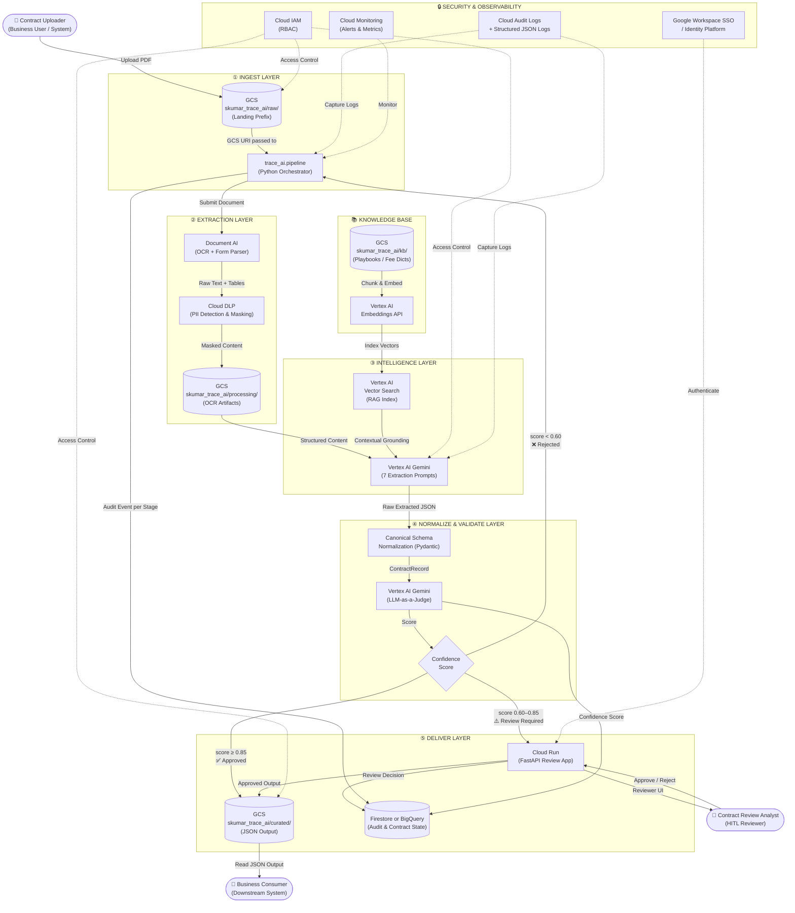
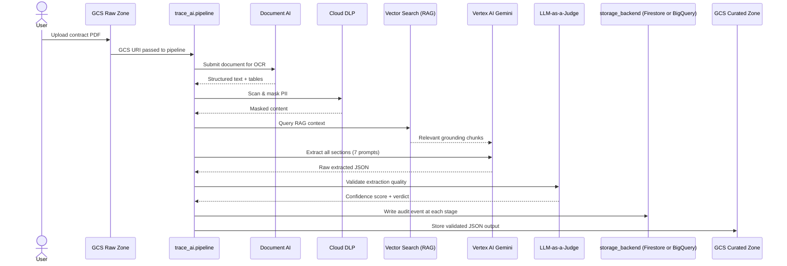
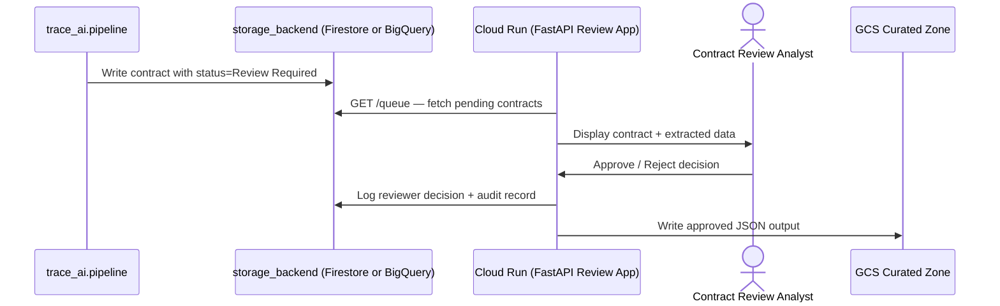
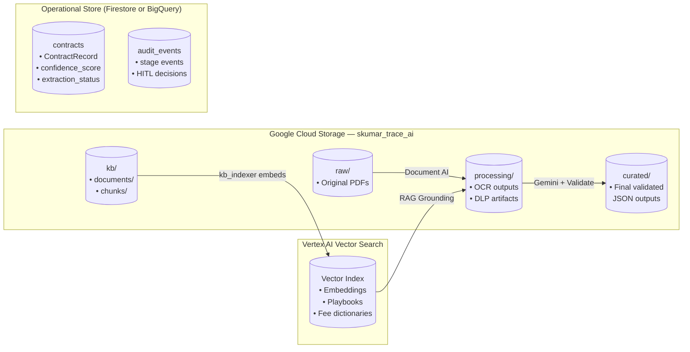
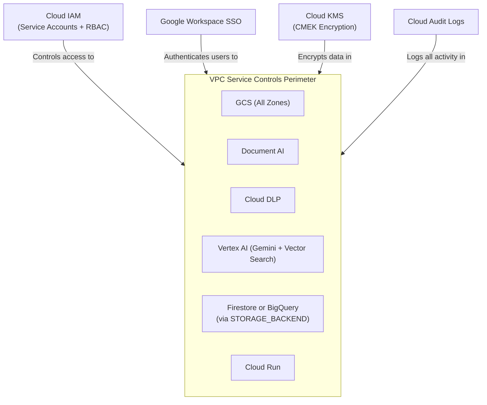

# TRACE Platform — GCP Architecture Diagram

## Full System Architecture

---

## Component Interaction Summary

### Data Flow (Happy Path)

---

### Human Review Flow (Low Confidence Path)

---

## Stage-by-Stage Component Map

| Stage | Component | Role | Interacts With |
|-------|-----------|------|----------------|
| Ingest | GCS Raw Zone | Landing bucket for uploaded PDFs | trace_ai.pipeline |
| Ingest | trace_ai.pipeline | Python orchestrator — wires all 7 stages | All modules |
| Extract | Document AI | OCR, table & key-value extraction | Cloud DLP |
| Extract | Cloud DLP | PII detection & masking | Vertex AI Gemini |
| Extract | GCS Processing Zone | Stores OCR artifacts | Vertex AI Gemini |
| Intelligence | Vertex AI Vector Search | RAG index — contextual grounding | Vertex AI Gemini |
| Intelligence | Vertex AI Gemini | LLM extraction — 7 prompts (sections + LLM judge) | Canonical Schema |
| Normalize | Pydantic ContractRecord | Maps raw Gemini output to canonical schema | LLM-as-a-Judge |
| Validate | Vertex AI Gemini (LLM Judge) | Secondary Gemini call scores extraction quality | Confidence routing |
| Deliver | GCS Curated Zone | Final JSON output storage | Business Consumer |
| Deliver | Cloud Run (FastAPI Review App) | Jinja2 UI for analyst review and approval | storage_backend, GCS Curated |
| Deliver | Firestore or BigQuery (via storage_backend) | Audit trail, contract state, confidence scores | pipeline, Cloud Run |
| Security | Cloud IAM | RBAC for all GCP resources | All services |
| Security | Google Workspace SSO | Authenticates human users to review app | Cloud Run |
| Security | Cloud Audit Logs | Immutable activity log | All services |
| Security | Cloud Monitoring | Metrics, alerts, pipeline health | pipeline |

---

## Storage Zone Layout

---

## Security Boundary

